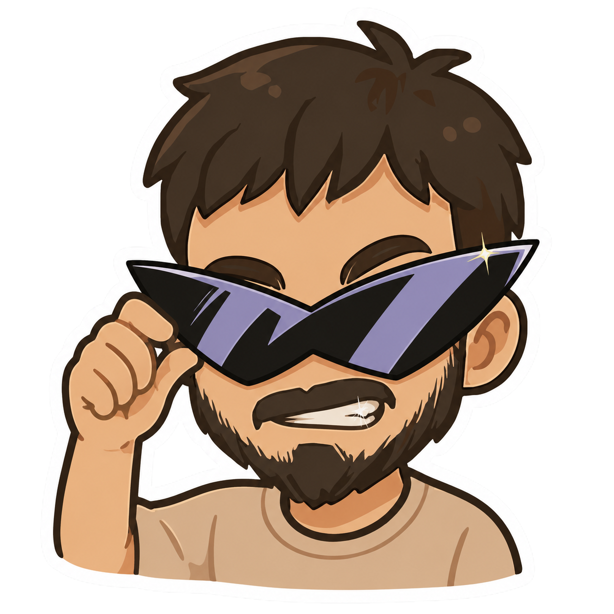
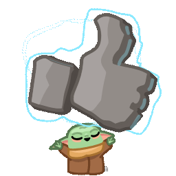
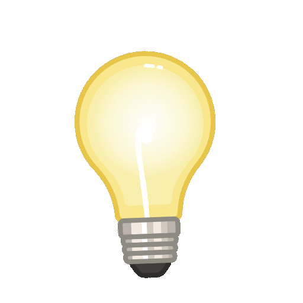
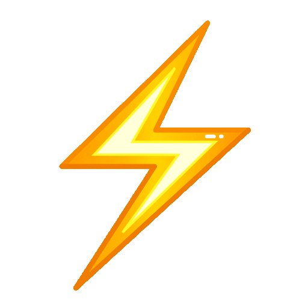
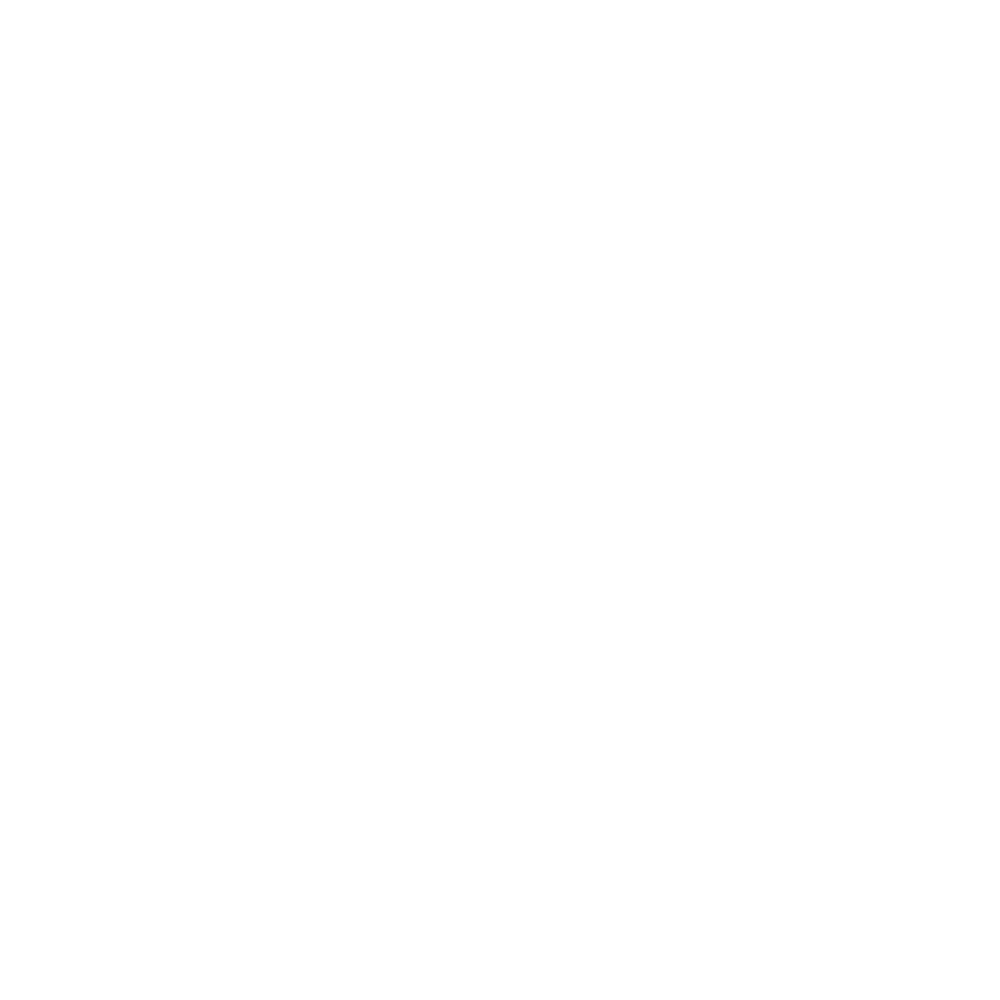

<h1 align="center">Hello fellas , What's up?</h1>

<div align="center">

</div>

<div align="center">
<a href="https://vinicius.is-a.dev/">Website</a> | 
<a href="https://vini.thedev.id/">Portfólio</a>
</div>

## My Social Medias!
[](https://instagram.com/vncsmnl)
[](https://twitter.com/vncsmnl)
[](https://www.threads.com/@vncsmnl)
[](https://br.linkedin.com/in/vncsmnl)
[](https://www.youtube.com/@oavassalador/)
[](https://www.reddit.com/user/vncsmnl)
[](https://steamcommunity.com/id/vncsmnl)
[](https://www.hackerrank.com/vncsmnl?hr_r=1)
[](https://leetcode.com/u/vncsmnl/)

## Padawan Developer!! 

-  PhD student in Computer Science, specializing in Biotechnology
-  I'm still stupid, I have a lot to learn... ✍️(◔◡◔)
-  I really like a lot of things, I'm always creating something new ...
-  Curious fact: "Vm9jw6ogw6kgYmVtIGludGVsaWdlbnRlIGhlaW4h" (*/ω＼*)

### About me! 

``` javascript
const me = {
    pronouns: ["Aesthetic", "Handsome", "Overwhelming"],
    code: ["Python", "C++"],
    askMeAbout: ["WebDev", "Tech", "Gaming", "Hacking", "Piracy", "Artificial Intelligence", "Machine Learning", "Deep Learning", "LLMs", "Cybersecurity", "Cloud Computing"],
    technologies: {
        ai_ml: {
            frameworks: ["TensorFlow", "PyTorch", "scikit-learn", "Keras", "XGBoost"],
        llm_tools: ["LangChain", "CrewAI", "OpenAI API", "Hugging Face"],
        backEnd: {
            python: ["Flask", "FastAPI"],
        },
        os: ["Linux", "macOS", "Windows"],
        devOps: ["AWS", "Docker"],
        databases: ["FAISS", "ChromaDB", "SQLite", "SupaBase"],
        misc: ["Latex", "Firebase", "MLflow", "NodeJS", "Bun", "Socket.IO", "Selenium", "BeautifulSoup", "open-cv", "pandas", "matplotlib", "numpy", "Bots", "GraphQL",  "Kubernetes",  "CI/CD"]
    },
    currentFocus: ["Python for AI"],
    altSider: ["JavaScript", "Rust", "Go", "Ruby"],
    hobbies: ["Soccer", "Video Games", "Gym", "Guitar", "Photograph"],
    languages: ["English", "Portuguese"],
    favoriteBooks: ["As a Man Thinketh", "Sapiens: A Brief History of Humankind", "The Code Breaker", "A Briefer History of Time"],
    favoriteShows: ["Spider-Man (2002)", "Grave of the Fireflies", "Interstellar", "BoJack Horseman",  "Breaking Bad", "The Office"],
    favoriteArtists: ["Bon Jovi", "Guns N' Roses", "Van Halen", "Pearl Jam"],
    fun: "Why did the neural network go to the doctor? It had a case of vanishing gradients and needed some help backpropagating its health!"
};
```
<p align="center">
  <a href="https://skillicons.dev">
    
  </a>
</p>

<div align="center">

</div>

<div></div> 
<div></div>
